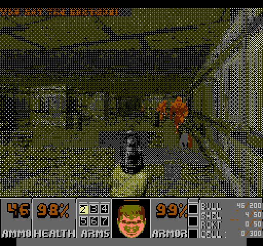
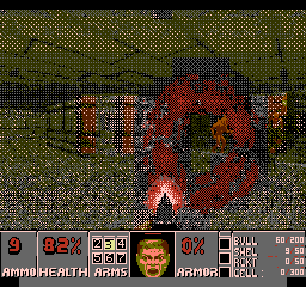
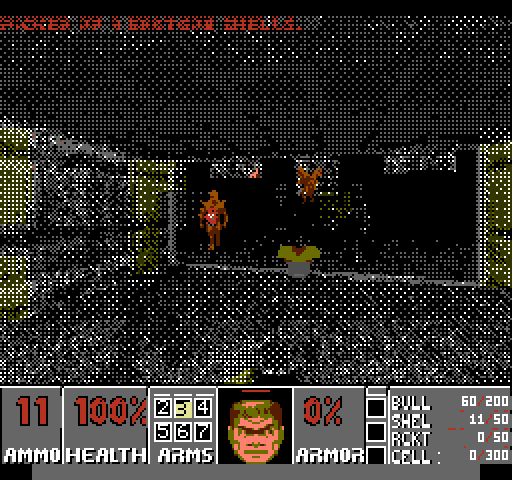

# FC PICO Doom

Shareware Doom running on the RP2350 inside an
[FC PICO](https://github.com/impact-soft/fc-pico) cartridge, and displayed and
played on an unmodified Famicom or NES. The engine is this repository's
[RP2040 Doom](../README.md), a Chocolate Doom derivative. The cartridge renders
each Doom frame, converts it to NES pattern data, and streams it to the
console's PPU. The console's own 6502 runs a small boot ROM that uploads
palettes and attributes, reads the controller, plays sound on the APU, and draws
the status bar, menus, enemies and pickups as native NES tiles and sprites.



Current console ROM: `20DOOM-05-9031`. It has been tested on an NTSC NES-001. See
[KNOWN-ISSUES.md](KNOWN-ISSUES.md) for current limitations.

## Hardware

- An FC PICO cartridge (RP2350, 4 MB QSPI flash). The console ROM bank is
  erasable flash: the cartridge carries a copy of its boot ROM and reflashes the
  console bank at boot when the version stamps differ. The fix bank at `$F000`
  is permanent and is never rewritten.
- A Famicom or NES. Only an NTSC NES-001 has been tested.
- A USB cable for flashing and the serial console.

## Flashing

1. **Keep the console powered off** while the cartridge is connected over USB.
2. Put the RP2350 into BOOTSEL mode. Either hold the BOOTSEL button while
   connecting it, or send the line `bootsel` over the USB serial port. Firmware
   built from this tree accepts it at startup and while running.
3. Copy the merged `fcpico_doom_whx.uf2` to the `RP2350` drive, or use
   `picotool load`. The UF2 holds the firmware, the console boot ROM image, the
   shareware WHX and, if built with them, the audio bank and world sprite
   atlas.
4. Unplug USB and power on the console. On the first boot after an update, the
   console reflashes its erasable bank (`ROM UPDATE`) and restarts into Doom.

Other serial commands: `stats`, `trace`, `dump pal`, `dump attr`,
`dump mailbox`, `reboot`.

## Controls

| Pad | Doom |
| --- | --- |
| D-pad | Move and turn |
| A | Fire |
| B (tap, ≤ 8 frames, no D-pad) | Use / open |
| B + Left/Right | Strafe |
| Select (tap) | Next weapon |
| Select (hold, 20 frames) | Automap |
| Start | Menu (A selects, B backs out) |
| Select + Start | Pause |

Always-run is enabled. Pad cheat sequences (`port/input/fcinput_cheats.h`) are
compiled only with `FCINPUT_ENABLE_CHEATS`, which the default build does not set.

## Building

### Toolchain pins

| Tool | Version |
| --- | --- |
| Pico SDK / picotool | 2.1.1 |
| Arm GNU Toolchain | 13.2.Rel1 (`arm-none-eabi-gcc` 13.2.1) |
| NESASM CE | `6fc41cda37b934aa29aa2639d0baa74424268e31` (native Linux build) |
| Python | 3.11+, packages in [`tools/requirements.txt`](tools/requirements.txt) |
| CMake / Ninja | CMake ≥ 3.20 |
| .NET | 10 (MesenCE cosimulation only) |

[`tools/setup_env.sh`](tools/setup_env.sh) provisions an Ubuntu 24.04 host. It
runs privileged installs, so read it first.

### Checkout

```sh
git clone -b fc-pico https://github.com/grebz-dev/rp2040-doom.git
cd rp2040-doom
git submodule update --init fcpico/external/fc-pico   # always
git submodule update --init fcpico/sim/mesen2/Mesen2  # only for cosimulation
python3 -m venv fcpico/.venv && fcpico/.venv/bin/pip install -r fcpico/tools/requirements.txt
```

`fcpico/external/fc-pico` is the pristine upstream
[impact-soft/fc-pico](https://github.com/impact-soft/fc-pico). The boot ROM
build includes its permanent fix bank, and tests compare against its tutorial
firmware. The engine's `3rdparty/tinyusb` submodule is not needed for this
target.

### Flashable image

```sh
FCPICO_AUDIO_WAD=/path/to/doom1.wad FCPICO_WORLD_WAD=/path/to/doom1.wad \
    fcpico/tools/build_device.sh
```

This writes `.build/fcpico-device/artifacts/fcpico_doom_whx.uf2` with a
`SHA256SUMS` file, a `build-info.txt` and the source diff. Overrides:
`ARM_TOOLCHAIN_PATH` (default: `arm-gnu-toolchain-13.2.Rel1-x86_64-arm-none-eabi`
in the repository root), `PICO_SDK_PATH`, `PICOTOOL_DIR`, `NESASM_BIN`,
`BUILD_DIR`, `JOBS`. `fcpico/tools/build_firmware.sh --bootstrap-tools` builds
the pinned picotool and NESASM into `.build/tools` if they are missing.

- The WADs are optional. They enable the generated APU audio bank and the
  native world sprite atlas. Both are generated from your local WAD into build
  outputs and are never committed.
- `build_device.sh` generates the current console ROM source
  (`tools/build_world_sprite_rom.py`) and builds the hardware-validated device
  profile: `MinSizeRel`, `FCPICO_DIAGNOSTIC_ENGINE_DELAY=ON`, and a picotool-generated
  UF2. A plain CMake device configure assembles the committed
  `bootrom/src/PG_main.asm`, which is the older `20DOOM-02-0002` ROM.
- Firmware UF2s must come from picotool. Do not wrap `fcpico_doom.bin` in UF2
  blocks by hand.

### Host tests

```sh
cmake -S fcpico -B build-host -G Ninja -DFCPICO_HOST_ONLY=ON
cmake --build build-host && ctest --test-dir build-host --output-on-failure
fcpico/.venv/bin/python -m pytest fcpico/tests fcpico/sim/pioemu -q
fcpico/.venv/bin/python fcpico/tools/gen_protocol.py --check
```

Boot ROM tests additionally need `NESASM_BIN` and `fcpico/bootrom/build.sh`.
Tests that need `FCPICO_AUDIO_WAD` skip without it.

### SDL-free host engine

```sh
cmake -S fcpico -B build-engine -G Ninja -DPICO_PLATFORM=host -DPICO_SDK_PATH=/path/to/pico-sdk
cmake --build build-engine --target doom_tiny_fcpico host_shim_test
build-engine/rp2040-doom/src/fcpico_doom_host --whx doom1.whx --demo 1 --frames 600 \
    --lockstep --dump-8bit frames --dump-stream streams
```

The host engine composes the same indexed frames and NES streams as the device.
`--pads FILE` replays controller input; `--world-dump` records world sprite
generations.

### MesenCE cosimulation

`fcpico/sim/mesen2/Mesen2` is a MesenCE fork with one extra mapper
(`Core/NES/Mappers/Homebrew/FcPico.h`, private NES 2.0 ID 4093). Its PPU reads
and writes go to the host cartridge model in `sim/cartmodel/`, which runs the
same bus core as the firmware. Mesen executes the console side only. It does
not emulate the ARM, PIO or electrical timing.

```sh
fcpico/sim/mesen2/build.sh                    # host cartridge model + MesenCE
fcpico/sim/mesen2/run_scenario.sh S0          # strict test-pattern scenario
fcpico/.venv/bin/python fcpico/sim/mesen2/run_doom_frame.py streams/frame000100.bin \
    --rom fcpico/bootrom/out/doom.nes --output d1        # fixed Doom frame (D1)
fcpico/.venv/bin/python fcpico/sim/mesen2/run_world_runtime.py --help  # v5 runtime and FPS model
```

- **D1** checks the picture against an independent decoder. It also checks all
  128 mailbox bytes, every post-startup heartbeat count, and NMI completion.
- **S1** is reflash: pass `--rom` with one ROM and `--serve-rom` with another.
  It passes only if the console's PRG ends up equal to the served image.
- **`run_world_runtime.py`** replays host-recorded world-sprite generations
  through the cartridge model and reports modelled FPS. Its device timing
  assumptions are recorded in the JSON report and are not hardware
  measurements.

Set `DOTNET_ROOT` if Mesen cannot find its runtime.

## Repository map

| Path | Contents |
| --- | --- |
| `src/fcpico/` | Engine platform layer: video composition into 8-bit indexed lines, input, sound/music modules, world sprite admission, host runner |
| `src/doom/*`, `src/*.c` | Small `FCPICO`-guarded engine changes (menus, status bar capture, sound registration, save naming) |
| `fcpico/CMakeLists.txt` | Cartridge superbuild entry (`cmake -S fcpico`). It adds the engine as a subdirectory with `FCPICO_SUPERBUILD`. |
| `fcpico/fcbus/` | Cartridge bus: protocol definitions, shared core, host and device backends, PIO programs |
| `fcpico/port/` | Device glue: video converter, native UI and world sprite packets, APU sequencer, input, audio bank, flash layout, CLI, trace |
| `fcpico/bootrom/` | Doom boot ROM erasable bank, native build and tutorial reproducibility gate |
| `fcpico/testpattern/` | Bring-up firmware that streams test patterns |
| `fcpico/assets/` | Hand-edited native art (`.chr`/`.bin`/`.json`) and the world sprite scope |
| `fcpico/tools/` | ROM generators, WAD/audio/atlas converters, stream/trace decoders, packaging and layout checks, performance tools |
| `fcpico/sim/` | Host shim, host cartridge model, PPU-bus model, PIO emulator tests, MesenCE fork and runners |
| `fcpico/tests/` | CTest and pytest suites, goldens and the hardware trace fixture |
| `fcpico/external/fc-pico/` | Pristine upstream FC PICO (fix bank, tutorial ROM and firmware references) |

## Engine integration

- The top-level `CMakeLists.txt` skips its own SDK import and `project()` when
  `FCPICO_SUPERBUILD` is set. `src/CMakeLists.txt` then adds
  `doom_tiny_fcpico`: the tiny-WHX build plus `FCPICO=1`, `NO_USE_ENDDOOM=1`,
  `USE_PICO_NET=0`, `USB_SUPPORT=0`, `TINY_WAD_ADDR=0x10080000`,
  `FCPICO_AUTO_SAVENAME=1`, and no `pico-extras`. The original VGA targets are
  unchanged when `FCPICO_SUPERBUILD` is unset.
- `i_video_fcpico.c` replaces scanvideo. Scanline composition writes 8-bit
  palette indices into a 320-byte line buffer, and frame begin/end hand the
  console palette and video type to the converter via `fcpico_video_sink.h`.
  Everything that runs while flash is being programmed is RAM-resident.
- `device_video_fcpico.c` runs the bus on core 1. A heartbeat-driven low-priority
  IRQ converts frames and schedules native UI and world sprite packets.
- `i_input_fcpico.c` turns latched controller bytes into Doom events
  (`port/input/fcinput.c`).
- `i_sound_fcpico.c` forwards sound and music to the APU register sequencer
  (`port/apu/`), driven by console heartbeat interrupts. It uses no ADPCM, OPL
  or I2S.
- `world_sprites.c` defers eligible enemies and pickups during projection,
  admits them after BSP, and rasterizes them against the renderer's depth
  information. Admitted actors stay out of the background stream; the rest are
  streamed as before.
- `host_main.c` is the SDL-free host entry point. The pico-sdk functions the
  host platform lacks (multicore, alarms, hard assertions) come from
  `fcpico/sim/host_shim/`.

## Bus and stream facts

- `fcbus/fcbus_protocol.h` is the single source of opcodes, mailbox fields,
  counts and key bits. `tools/gen_protocol.py` regenerates
  `bootrom/gen/protocol.inc` and `tools/fcpico/protocol.py`, and `--check`
  fails on stale output. v1 wire values match the FC PICO tutorial and must
  not change; later versions only extend them.
- The cartridge sees only CS1-qualified PPU reads. Hardware trace 6 (NES-001,
  `tests/fixtures/hw_trace_ntsc/`) measured 66 qualifying reads on the
  pre-render line and 64 on each visible line. With the v1 protocol, one frame is
  `66 + 240×64 + 1 dummy + 64 mailbox = 15491` physical reads. The PIO counter
  reports the zero-based last index, `15490`. Later protocol versions change
  the mailbox and heartbeat (v2: `15554`; current v4/v5 ROMs: `15122`).
- Pattern fetch selection depends on PPU addresses: nametable 0 uses tile
  `$80` (`$0800`), nametable 1 uses tile `$00`, and the ROM restores `$0801`
  after its heartbeat so that pre-render reads stay at 66. Changing any of
  these needs a new hardware trace.
- The picture stream is flat: 32 16-bit words per visible line, starting at
  word 31. `VRAM_LINE_WORDS=34` is the converter's batch size, not the line
  stride.
- The bus ISR and the converter paths used while flash is being programmed must
  stay in RAM. Core 1 does not allocate after init and never logs from the bus
  ISR.

## Flash layout

`port/flash_layout.h` is the single source of truth, and
`tools/flash_layout_check.py` enforces it at build time.

| Region | Address | Size |
| --- | --- | --- |
| Firmware (code, boot ROM image) | `0x10000000` | 512 KB |
| WHX (`TINY_WAD_ADDR`) | `0x10080000` | 2 MB (shareware: 1,800,344 B) |
| World sprite atlas | `0x10280000` | 512 KB |
| Audio bank / asset archive | `0x10300000` | 512 KB |
| Saves | `0x10380000` | 512 KB, options in the last 4 KB sector |

## Testing layers

The layers check different properties. A passing emulator run does not
establish physical bus timing.

- **Host C (CTest):** bus core and host backend (sync, mailbox, rx, stream),
  converter and world sprite packets, APU sequencer, input, cartridge model,
  host shim. A sanitizer job builds the same tests with ASan/UBSan.
- **Python (pytest):** protocol freshness and v1 parity with the tutorial
  sources, stream encode/decode, the PPU-bus model against hardware trace 6,
  NES/ROM tools, audio converters, art round-trips, packaging and layout checks.
- **PIO (`sim/pioemu/`):** assembles the real `fcbus/fcppu.pio` with
  `adafruit_pioasm` (after `conftest.py` preprocessing) and runs one state
  machine at a time in `rp2040-pio-emulator` 0.88. That emulator does not
  implement `irq` set/wait/clear and has only 4-word FIFOs, so the
  `fcppu_r` → `fcppu_dir` bus turnaround is checked only on hardware.
- **NMI cycles (`tests/bootrom/`):** runs the boot ROM's NMI under py65 from the
  fixed `$ED00` trampoline through `RTI`. It adds a 7-cycle interrupt entry and
  a flat 513 cycles per OAM DMA, so totals are a lower bound (real DMA can take
  514). It compares totals against the 2273-cycle NTSC vblank.
  `tutorial_nmi_cycles.json` is regenerated on every run.
- **Engine goldens (`tests/goldens/`):** hashes of DEMO1 frames, and title/menu
  frames, from the host engine.
- **Performance (`tools/perf/`):** runs the real C converter and world sprite
  code as Cortex-M33 machine code in Unicorn. It counts instructions, not
  RP2350 cycles or console FPS.
- **Mesen scenarios:** see above.
- **Hardware:** `tests/fixtures/hw_trace_ntsc/` keeps the raw serial captures.
  `trace_6.hex` is the only complete calibration capture; traces 1–5 are
  incomplete and kept for diagnosis. Decode it with
  `tools/trace_decode.py fcpico/tests/fixtures/hw_trace_ntsc/trace_6.hex --json`.

Host shim limits: pico-sdk's host `hardware_sync` spin locks are single-threaded
dummies, so SDK semaphores shared across real threads can race. The shim's
inter-core FIFO is two blocking 8-entry queues, which deadlock just as hardware
would if both sides push without draining. Cancel shim timers with
`host_cancel_repeating_timer()`; the SDK's `cancel_repeating_timer()` panics on
host.

## Editing native art



The native status face, menu logo and episode labels are 2-bit NES tiles in
`assets/*.chr`, with tile maps and flips in the `.bin` and `.json` files. To
edit them as pixel-exact PNGs:

```sh
fcpico/.venv/bin/python fcpico/tools/edit_sprite_sheets.py export large_faces
# edit fcpico/assets/doomguy_faces_large_edit.png at 100%, nearest neighbour,
# using only transparency and the three colours already in the sheet
fcpico/.venv/bin/python fcpico/tools/edit_sprite_sheets.py import large_faces
```

The sheets are `logo`, `pause_logo`, `faces`, `large_faces` and `paired_text`;
leave the name out to process all of them. Exported PNGs are ignored by git. The
importer rejects off-palette pixels, and for `large_faces` it deduplicates
equal or flipped tiles and enforces the 128-tile resident limit. The
`build_*_art.py` generators recreate these sources from a WAD and overwrite
manual edits, so keep a copy first. Then rebuild with `build_device.sh`.

World sprites are generated at build time from your IWAD
(`tools/build_world_atlas.py`). `assets/world-sprite-scope.json` lists the
sprite families, their reviewed palette overrides and exclusivity. Families
outside the atlas are streamed with the background.



## Licensing

| Component | Licence |
| --- | --- |
| Doom engine (this repository outside `fcpico/`) | GPLv2 for Chocolate Doom-derived code; BSD-3-Clause for RP2040 Doom-specific code; see [README.md](../README.md) |
| `src/fcpico/` | GPLv2 where derived from `src/pico/`, otherwise as marked |
| `fcpico/` code | BSD-3-Clause unless a file's SPDX header says otherwise |
| `fcbus/fcppu.pio` | Derived from the FC PICO tutorial's `fcppu.pio`: BSD-3-Clause header (Raspberry Pi (Trading) Ltd.) with impact soft modifications whose terms are unconfirmed |
| `bootrom/` | Derived from the FC PICO tutorial `BOOTROM/`; impact soft terms |
| Fix bank, tutorial ROM | Not redistributed here: taken from the pristine `external/fc-pico` submodule |
| `assets/*.chr`, `*.bin` | Hand-edited derivatives of shareware Doom art, under id Software's shareware terms like `doom1.whx` |
| World atlas, audio bank | Generated locally from your WAD; never committed |
| MesenCE fork (cosimulation only) | GPL-3.0; not part of the firmware |

The palette table in `tools/build_world_atlas.py` is MesenCE's default 2C02
palette, kept as data so the atlas matches what the emulator displays.

## Credits

[RP2040 Doom](https://github.com/kilograham/rp2040-doom) by Graham Sanderson,
[Chocolate Doom](https://github.com/chocolate-doom/chocolate-doom),
[FC PICO](https://github.com/impact-soft/fc-pico) by impact soft,
[MesenCE](https://github.com/SourMesen/Mesen2),
[NESASM CE](https://github.com/ClusterM/nesasm),
[py65](https://github.com/mnaberez/py65) and
[rp2040-pio-emulator](https://github.com/NathanY3G/rp2040-pio-emulator).
